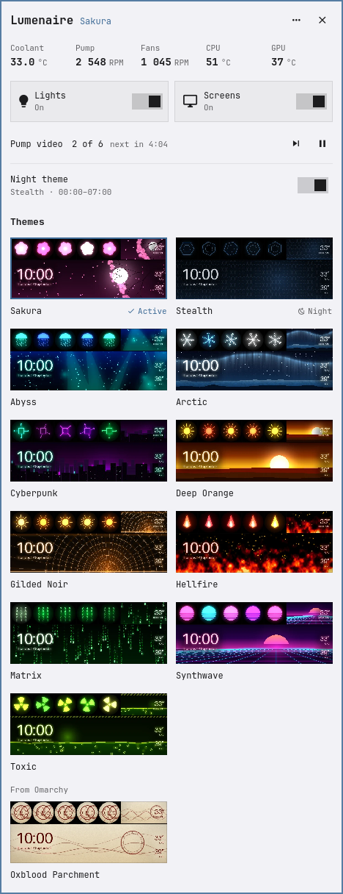
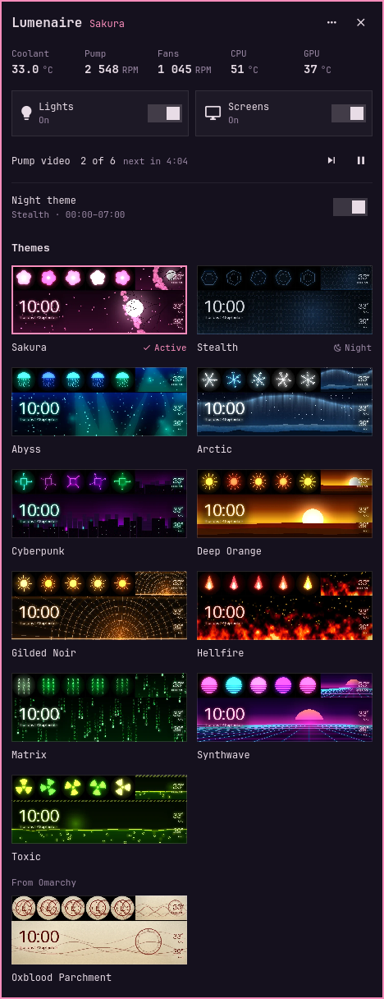

# Lumenaire

**Your PC case lighting, from the Omarchy bar.** Lumenaire themes every light
in your case (fans, Strimer cables, the pump ring, GPU, motherboard and RAM)
and the Lian Li LCD screens, from one theme file, and keeps them in step with
your Omarchy theme and a day/night schedule.

It comes in two parts:

- **`lumenaire`**, the engine: a command-line tool that turns a theme into
  lighting through [lian-li-linux](https://github.com/sgtaziz/lian-li-linux)
  and [OpenRGB](https://openrgb.org), plays media on the LCD screens, and runs
  the schedule, the clip rotation and the Omarchy pairing. It works on its own.
- **Lumenaire for Omarchy**, the bar plugin: pick a theme from previews, switch the lights
  and screens, skip the pump clip, and watch pump RPM, coolant, CPU and GPU
  temperature without opening a terminal. It never changes anything itself:
  every change goes through `lumenaire`.

| Light (Glass White) | Dark (Sakura) |
| --- | --- |
|  |  |

The screenshots are offscreen renders of synthetic fixture data: real theme
names, previews drawn from each theme's colours (`tests/fixtures/previews/make.py`)
and made-up readings. The plugin follows your current Omarchy theme and font.

**Naming.** The product is Lumenaire; the engine command is `lumenaire` and
the Omarchy plugin is "Lumenaire for Omarchy" (`io.github.nocstah.lumenaire`).
It was briefly called OmaLights; that name is retired. The engine's first
name, `pc-lights`, stays as a working alias, and everything already on disk
keeps it: the systemd units (`pc-lights*.service`/`.timer`), the Omarchy hook
(`theme-set.d/pc-lights`), the journal tag (`journalctl --user -t
pc-lights`), the state folders `~/.config/pc-lights/` and
`~/.cache/pc-lights/`, and the `PCL_*` environment variables.

- [Supported hardware](#supported-hardware)
- [Requirements](#requirements)
- [Install](#install)
- [First run](#first-run)
- [Themes](#themes)
- [The plugin](#the-plugin)
- [Workarounds](#workarounds)
- [Documentation](#documentation)
- [Development and checks](#development-and-checks)

## Supported hardware

Anything one of the two backends can drive. You don't need both: a PC with
only OpenRGB devices, or only Lian Li gear, works, and the missing half is
skipped.

| Backend | Devices | Notes |
| --- | --- | --- |
| lian-li-linux | Lian Li wireless fans (UNI FAN TL, SL, SL-INF), Strimer Plus Wireless, HydroShift and Galahad AIO pump rings, TL fan LCDs, pump LCDs (HydroShift II OLED Curve, round HydroShift/Galahad), the Universal Screen 8.8" and its ring | tested most on TL V3 LCD fans, Strimers, a HydroShift II OLED Curve and a Universal Screen 8.8" |
| OpenRGB | GPUs, motherboards and their addressable RGB headers, RAM, and (only if you opt in) keyboards, mice, mousepads, headsets | whatever your OpenRGB version supports; RAM on AMD boards usually needs the SMBus set up (see below) |

The panel's pump and coolant readings need a Lian Li AIO that reports them;
CPU and GPU temperatures come from hwmon or `nvidia-smi` on any PC.

## Requirements

- **Omarchy 4** with the Quickshell-based shell, for the plugin and the theme
  pairing. The engine alone runs on any systemd Linux desktop.
- `jq`, `socat`, `python3`, `flock` and `systemd-run` (util-linux and
  systemd; already there on most systems).
- `ffmpeg` and ImageMagick (`magick`) for theme previews, generated themes
  and putting your own pictures and videos on the screens, `inotify-tools`
  for the plugin (without it the panel polls every 5 s), and optionally
  `nvidia-smi` for an NVIDIA GPU temperature.
- For Lian Li gear: the **lian-li-linux** user daemon (`lianli-daemon.service`,
  on Arch the AUR package `lianli-linux-git`), running and with its udev rules
  installed.
- For everything else: **OpenRGB** with its udev rules
  (`60-openrgb.rules`) and the `i2c-dev` module loaded
  (`echo i2c-dev | sudo tee /etc/modules-load.d/i2c-dev.conf`). On AMD, RAM
  lighting also needs `i2c-piix4`, and many boards need
  `acpi_enforce_resources=lax` on the kernel command line before OpenRGB
  lists the RAM sticks. Turn **off** OpenRGB's Lian Li detectors (Settings,
  Supported Devices) when you use lian-li-linux, so the two never fight.

On Omarchy / Arch:

```bash
sudo pacman -S --needed jq socat python ffmpeg imagemagick inotify-tools openrgb
yay -S lianli-linux-git          # if you have Lian Li gear
```

`lumenaire install` checks all of this and tells you what is missing.

## Install

1. Add the plugin (it carries the engine):

   ```bash
   omarchy plugin add https://github.com/nocstah/lumenaire --enable
   ```

   If the `--enable` half answers `omarchy-shell is not responding`, the
   plugin is installed but the shell took longer than two seconds to rescan;
   run `omarchy plugin enable io.github.nocstah.lumenaire` once more. The
   widget lands on the right of the bar; move it with
   `omarchy bar move io.github.nocstah.lumenaire --section left`.

2. Install the engine from the plugin folder:

   ```bash
   ~/.config/omarchy/plugins/io.github.nocstah.lumenaire/bin/lumenaire install --dry-run --all
   ~/.config/omarchy/plugins/io.github.nocstah.lumenaire/bin/lumenaire install --all
   ```

   This links `~/.local/bin/lumenaire` (and its old name
   `~/.local/bin/pc-lights`) to the plugin's copy, installs the
   systemd user units (login re-apply, the day/night and clip timers), the
   Omarchy theme-set hook and the example themes, then enables the timers.

| Option | Does |
| --- | --- |
| *(none)* | check the requirements and link `~/.local/bin/lumenaire` and `~/.local/bin/pc-lights` |
| `--units` | the systemd user units, then `daemon-reload` and enable (the login unit is enabled, not started) |
| `--hook` | `~/.config/omarchy/hooks/theme-set.d/pc-lights` |
| `--examples` | copy the example themes, never over a theme of the same name |
| `--workarounds` | the TL fan LCD wake step, only if your profile has TL fan LCDs |
| `--desktop` | the desktop wallpaper follows the theme (with the Motion Wallpaper plugin): `~/.local/bin/motion-wallpaper-theme`, its theme-set hook, `motion-wallpaper-theme.path` and `motion-wallpaper-monitors.service` (a theme's portrait clip on portrait monitors, followed across hot-plugs); prints a key binding for moving/still (docs/ENGINE.md, "Desktop wallpaper") |
| `--all` | `--units --hook --examples` |
| `--dry-run` | print every step and diff, write nothing |
| `--replace` | replace a file that is in the way of a link (it is backed up first) |
| `--force` | replace a unit, hook or drop-in that differs from the shipped one (after showing the diff and a backup) |

Nothing you already have is overwritten without `--replace` or `--force`, and
the backups go to `~/.cache/pc-lights/install-backup/`. The engine can also
run from a clone: `git clone … && ./bin/lumenaire install --all` links
both names to the clone instead (edits there go live at once).

**What it writes.** The plugin writes nothing but its bar entry in
`~/.config/omarchy/shell.json`. The engine keeps its state in
`~/.config/pc-lights/` and `~/.cache/pc-lights/`, and writes lian-li-linux's
config (`~/.config/lianli/config.json`) for you: don't edit that file by hand
while lumenaire is in use.

**Remove it** with `omarchy plugin remove io.github.nocstah.lumenaire`, then
`systemctl --user disable --now pc-lights.service pc-lights-schedule.timer
pc-lights-clips.timer`, and delete `~/.local/bin/lumenaire`,
`~/.local/bin/pc-lights`, the units in
`~/.config/systemd/user/pc-lights*` and the hook. The lighting stays as it is.

## First run

```bash
lumenaire detect --dry-run     # what it found; writes nothing
lumenaire detect               # writes ~/.config/pc-lights/profile.json
lumenaire explain aurora       # which colour goes to which device
lumenaire render aurora        # the exact result, without touching anything
lumenaire pick aurora          # apply it; it also becomes your day theme
```

`detect` finds your devices and names their places in the case (roles such as
`fans.side`, `strimer.gpu`, `pump.ring`, `screen.fan1`). Fan positions are a
guess; correct one with `lumenaire profile set fans.top <device>` or by
editing the profile, and detect keeps your edits next time. See
[docs/PROFILE.md](docs/PROFILE.md). The plugin shows a **Detect** button
until a profile exists.

Other useful commands:

```bash
lumenaire status               # what is set, what is running, screens on USB
lumenaire off | on             # all lights; "off screens", "on all"
lumenaire schedule on          # day/night switching (~/.config/pc-lights/schedule.json)
```

## Themes

A theme is one folder, `~/.config/pc-lights/themes/<name>/`. The smallest
one is a palette:

```json
{
  "v": 3,
  "_about": "Ember: a banked fire.",
  "palette": {"primary": "ff4a00", "secondary": "ff1400", "accent": "ff6a0a", "alert": "00b4ff"}
}
```

lumenaire derives every light from it on any PC. Add `roles` to set a device
group exactly (fans' inner and outer edges, the Strimer effect, a GPU
gradient, a RAM gradient), and `screens` to put images, videos or a Universal
Screen template on the LCDs. Screens are keyed by role (`screen.fan`,
`screen.pump`, `screen.main`), never by serial, and media only goes to a
screen of the shape it was made for, so a theme made on one PC works on
another. The panel's editor sets them too (see below).

LEDs aren't monitors: green is much brighter, so warm colours need little
green and pastels read white. [docs/THEMES.md](docs/THEMES.md) has the full
schema and the colour rules, and [docs/CALIBRATION.md](docs/CALIBRATION.md)
explains the per-PC colour correction.

With the Omarchy hook, every Omarchy theme gets a matching case theme,
generated in a few seconds from its palette and wallpaper, unless you map it
to one of yours in `~/.config/pc-lights/omarchy-map.json`.

## The plugin

### What it does

- **Themes**: a grid of your case themes, each with a preview of its screens.
  Click one to apply it; it also becomes your day theme. Hand-made themes come
  first, themes generated from Omarchy colour schemes follow. A small note
  under a card says when this PC can't show all of it.
- **New theme and editing**: ＋ New starts from one colour, your desktop's
  colours, a copy of a theme or a random palette, then asks for a name. The
  editor (Edit in the header, the pencil on a card, or its right-click menu)
  sets the three theme colours and each part of the case, with a live preview
  on the case; your changes are kept as a draft until you save.
- **Screens**: the editor shows the case's LCDs as a small map. Click one to
  change what it shows: a video or picture from the theme, your other themes
  and L-Connect clips (Library) or your own Videos and Pictures folders (My
  files). A file of another shape opens a crop page to frame it; the engine
  prepares it for that screen in the background (the panel says how far it
  has got), and it shows on the case at once with the live preview. The pump
  can take turns between several clips, the 8.8" screen switches between its
  clock-and-stats layout and a picture or video, and each screen has its own
  brightness. Your files are only read, never changed; the theme keeps its
  own copy when you save.
- **Lights and screens**: one switch for every light and one for the LCDs.
- **Pump video**: which clip the pump screen shows and when the next one
  comes, with Skip and Pause / Resume. Middle-click the bar icon for the next
  pump clip.
- **Live**: coolant, pump, the average fan speed (each group in its tooltip),
  CPU and GPU temperature; wireless devices that are out of range and screens
  missing from USB. Readings your PC doesn't have are hidden.
- **Night theme**: the night theme and hours, on or off; the Omarchy pairing
  is in its tooltip.
- **Wallpaper**: with the Motion Wallpaper plugin, each theme keeps its own
  desktop wallpaper settings: animated or still, holding still while you type
  or move the mouse, how soon it moves again, and whether it freezes or shows
  the still image meanwhile. A row on the main page switches it for the theme
  the desktop follows and opens its page; Wallpaper… in a card's right-click
  menu opens any theme's. Changes apply at once.
- **Honest progress**: an apply takes seconds to a few minutes. The bar shows
  "…" while it runs, the panel says which step it is on and for how long, and
  a failure stays red until you have seen it.

### Bar widget and panel

The bar shows a lightbulb (crossed out while the lights are off), a small dot
in the active theme's lead colour, and a reading (coolant when you have a
pump, else CPU temperature). The reading turns red at your coolant warning,
or when the CPU or GPU reaches the heat-alert threshold.

| Input | Does |
| --- | --- |
| Left click | Open or close the panel |
| Right click | Open or close the panel (or toggle every light, see `rightClick`) |
| Middle click | Next pump clip |
| Tab (in the panel) | Move to the neighbouring bar panel |
| Arrows, Enter | Move through the theme grid and apply |
| e, n | Edit the theme under the cursor (or the active one), start a new theme |
| Menu key | The card menu: Edit, Wallpaper, Duplicate, Rename, Delete |
| Escape | Close a menu or confirm, then the panel |

In the editor, j/k walk every row (the screens on the case map too) and Enter
opens one; a screen's page, its picker, its crop page and the wallpaper page
have their own keys (DESIGN.md, "Keyboard").

**How changes run.** Each change is started as its own short-lived systemd user
unit (`lumenaire --detach …`) and the panel follows it through
`lumenaire status --json`. Closing the panel, restarting the shell or
reloading the plugin never interrupts an apply. Clicking several themes in a
row is fine: the last pick wins, the others are dropped before they start.

Two picks ask first: re-applying the active theme, and picking a day theme
while the night theme is running (it overrides the night theme until the next
boundary). Lights, screens and the schedule wait while an apply holds the
engine's lock; theme picks queue.

With the lights off, a pick is saved and applies when the lights come back on.
The LCDs keep showing the previous theme's media until then, and the panel says
so.

### Settings

Set them with `omarchy bar set io.github.nocstah.lumenaire <key> <value>`,
adding `--json` for numbers and booleans.

| Key | Default | What |
| --- | --- | --- |
| `show` | `auto` | Bar readout: `auto` (coolant with a pump, else CPU), `coolant`, `pump`, `both` or `none`. |
| `coolantWarn` | `40` | The readout turns red at or above this coolant temperature (°C). |
| `showGpu` | `true` | Show GPU temperature in the panel; reads the GPU sensor only while the panel is open. |
| `rightClick` | `panel` | `lights` makes right click toggle every light instead. |
| `showDot` | `true` | The small dot under the icon in the case theme's lead colour. |

Example: `omarchy bar set io.github.nocstah.lumenaire show both`.

### Scripting

The service answers on the `lumenaire` IPC target:

```bash
omarchy-shell lumenaire status | jq     # theme, lights, engine, daemon, pump, coolant, …
omarchy-shell lumenaire pick hellfire   # "queued" or "error: …"
omarchy-shell lumenaire lights toggle   # on, off or toggle
omarchy-shell lumenaire screens off
omarchy-shell lumenaire skip            # next clip: "queued" or "busy"
omarchy-shell lumenaire pause           # pause / resume the clip rotation
omarchy-shell lumenaire refresh
omarchy-shell shell toggle io.github.nocstah.lumenaire   # open the panel
```

A keybinding for the panel, if you want one, goes in `~/.config/hypr/bindings.lua`
(check first that the combination is free):

```lua
o.bind("SUPER + ALT + L", "Case lights", "omarchy-shell shell toggle io.github.nocstah.lumenaire")
```

The plugin needs the engine with its JSON interface (`status --json`,
`themes --json`, `sensors --json`, `--detach`). It uses
`~/.local/bin/lumenaire`, then `~/.local/bin/pc-lights`, then the copy in its
own folder. An older engine shows "Lumenaire needs an engine with status
--json" and keeps
the live readings working.

If an update leaves old controls visible, close the panel and run
`omarchy restart shell` on an unlocked desktop.

## Workarounds

- **TL fan LCDs stay dark after a shutdown** (the fans show their built-in CPU
  temperature instead of your media): the wireless receivers keep the LCDs
  off USB, and lian-li-linux doesn't wake them. `lumenaire install
  --workarounds` adds a small wake step that runs before lianli-daemon starts
  (needs `uv`). It is only offered when your profile has TL fan LCDs.
- **Changes land late, or no pump RPM/coolant on a HydroShift II OLED Curve**:
  two lian-li-linux bugs with upstream fixes pending. Running a patched daemon
  is optional and manual; lumenaire never installs one. See
  [workarounds/lianli/README-fixed-daemon.md](workarounds/lianli/README-fixed-daemon.md).

**Known issue (not this plugin's):** writing into `~/.config/omarchy/plugins`
while the screen is locked makes the shell abort (Omarchy #8647). Install and
update plugins on an unlocked desktop.

## Documentation

- [docs/ENGINE.md](docs/ENGINE.md): commands, how an apply works, files,
  units, the JSON interface, the code layout
- [docs/PROFILE.md](docs/PROFILE.md): `detect`, roles, correcting the
  profile, screens and mounting, sensors
- [docs/THEMES.md](docs/THEMES.md): the theme schema, palette derivation,
  screens and models, LED colour rules, migrating v2 themes
- [docs/CALIBRATION.md](docs/CALIBRATION.md): per-PC LED colour correction
- [docs/BACKENDS.md](docs/BACKENDS.md): the backend interface, adding one

## Development and checks

```bash
omarchy plugin validate .
python tests/render.py                 # offscreen renders into .impeccable/review/
tests/engine-contract.sh               # engine contract, against a fixture $HOME
tests/golden/run.sh                    # render output byte for byte against captured goldens
```

`tests/render.py` draws every fixture in `tests/fixtures/` at 468 and 360 px on
a light and a dark palette through `tests/FakeService.qml`; it never touches
the daemon or the engine. `tests/engine-contract.sh` runs the real engine
against a scratch `$HOME` with its hardware calls stubbed out. Every engine
command honours `HOME`, so `HOME=$(mktemp -d) bin/lumenaire install
--dry-run --all` shows a fresh install without touching yours.

For a local install of the plugin, copy the working tree into a real directory
(the plugin folder may not contain symlinks):

```bash
rsync -a --delete --exclude .git ./ ~/.config/omarchy/plugins/io.github.nocstah.lumenaire/
```

## License

MIT. See [LICENSE](LICENSE).
